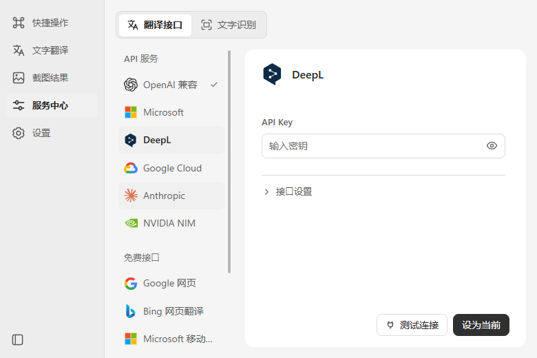
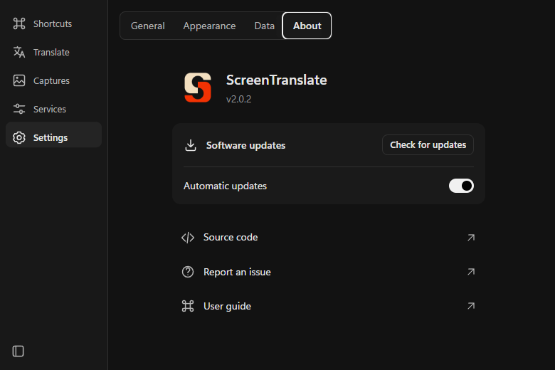

<p align="center">
  
</p>
<h1 align="center">ScreenTranslate</h1>
<p align="center"><strong>Select text. Read the translation in place.</strong></p>
<p align="center">Screen translation · Side-by-side text · Quick translation window</p>
<p align="center"><a href="README.md">简体中文</a> | <strong>English</strong></p>
<p align="center">
  <a href="https://github.com/reevebyte/ScreenTranslate/releases/latest"></a>
  <a href="https://github.com/reevebyte/ScreenTranslate/actions/workflows/v2-ci.yml"></a>
  <a href="LICENSE"></a>
</p>
<p align="center">
  <a href="https://github.com/reevebyte/ScreenTranslate/releases/latest"><strong>Download</strong></a> ·
  <a href="#quick-start">Getting started</a> ·
  <a href="https://github.com/reevebyte/ScreenTranslate/releases">Release notes</a> ·
  <a href="https://github.com/reevebyte/ScreenTranslate/issues/new">Report an issue</a>
</p>

| Light · Services | Dark · Settings and updates |
| :---: | :---: |
|  |  |

Screenshots show the native Windows application client area. Both Simplified Chinese and English interfaces are available.

## Download and install

Open the **[latest release](https://github.com/reevebyte/ScreenTranslate/releases/latest)** and choose the package for your system:

| System | File |
| --- | --- |
| **Windows 10 / 11 · x64** | **`*x64-setup.exe`**. Follow the installer; system WebView2 is required. |
| macOS 14+ · Apple Silicon | `*aarch64.dmg` |
| macOS 14+ · Intel | `*x64.dmg` |
| Linux · x64 | `.AppImage`; `.deb` and `.rpm` are also available. |

`.sig`, `latest.json`, `latest-v2.json` and `.app.tar.gz` files are used by the updater and do not need to be downloaded manually. GitHub's `Source code` archives are not installers.

Native interactions have been verified on Windows. macOS and Linux builds are available; the complete experience still needs verification on those systems.

## Features

- **Translate in place:** select screen text and view the translation at the same location. Compare, zoom, drag and correct recognized text.
- **Side-by-side text:** read the source and translation together, edit the source, translate again or copy either pane.
- **Quick translation:** bring up a compact window with a shortcut, then type or paste text.
- **Choose your services:** configure translation and OCR separately, including OpenAI-compatible endpoints, dedicated translation APIs, local OCR and cloud OCR.
- **Reading and updates:** light and dark themes, adjustable font size, Chinese and English interfaces, and in-app updates.

## Quick start

1. **Launch the app.** The first-run guide opens automatically. Select Get started to open Shortcuts.
2. **Select an area.** Press `Ctrl+Alt+Q`, drag to select text, then release. The translation appears in place.
3. **Choose services as needed.** Configure translation and OCR under Services, then select Set as current. Browsing a service does not activate it.

| Action | Default shortcut |
| --- | --- |
| Translate a screen selection | `Ctrl+Alt+Q` |
| Hide / show a capture | `Ctrl+Alt+W` |
| Quick text translation | `Ctrl+Alt+Space` |

Edit key bindings under Shortcuts. Change the interface language under Settings → General. Updates are under Settings → About; automatic checking on launch is enabled by default.

The defaults are Youdao cloud OCR and Google web translation, which require an internet connection. Local OCR is available under Services; translation connectivity depends on the selected service. Free web interfaces may be rate-limited or stop working. API services require your own credentials, with quotas and pricing set by each provider.

## Data and privacy

Captures, input text and translations are kept in session memory by default and cleared when the app closes. Settings are stored locally; API Keys use the system credential store. Cloud OCR receives the selected image, and translation services receive recognized or typed text. Local OCR does not upload screenshots.

## Help and feedback

[Bugs and feature requests](https://github.com/reevebyte/ScreenTranslate/issues/new) · [Release history](https://github.com/reevebyte/ScreenTranslate/releases) · [Custom OCR APIs (Chinese)](docs/custom-ocr-api.md)

<details>
<summary><strong>Development and builds</strong></summary>

Built with Rust, Tauri 2, Svelte 5, TypeScript, Tailwind 4, Bits UI / shadcn-svelte and Phosphor.

Requires Node.js 22, pnpm 11.7.0 and Rust 1.95.0. Windows also requires MSVC Build Tools and the Windows SDK.

```sh
pnpm install --frozen-lockfile
pnpm desktop
```

`pnpm dev` is a browser-only interface preview. Capture, system OCR and global shortcuts require the desktop app.

[Development (Chinese)](docs/v2.md) · [Design system](DESIGN.md) · [Validation (Chinese)](docs/validation.md) · [Memory and size (Chinese)](docs/performance.md) · [Release and updates (Chinese)](docs/updating.md)

</details>

## License

[MIT](LICENSE). Third-party resources and dependencies retain their own licenses; see [Third-party notices](docs/v2-third-party-notices.txt).
